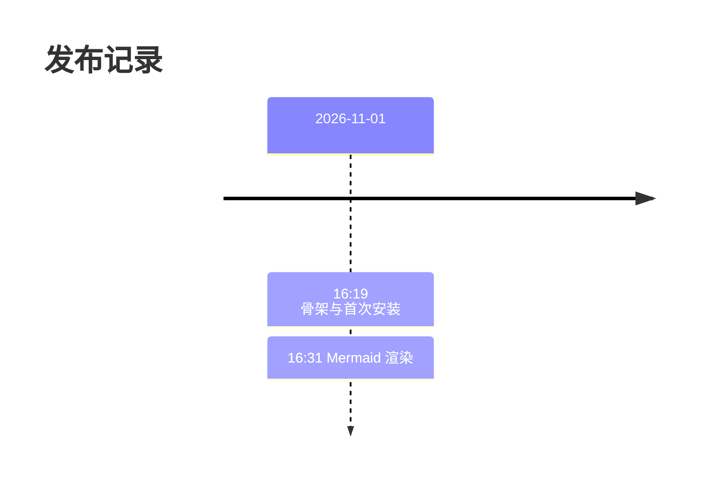

# Mermaid 写法速查

插件按「围栏首行的第一个词」判断是否渲染，不依赖代码块语言标签。下表是当前识别集合，与 `src/mermaid/detect.js` 的 `DIAGRAM_KEYWORDS` 一一对应；漏写会当成普通代码块。〔来源：[detect.js:24-79](../../src/mermaid/detect.js#L24-L79)〕

## 支持的首行关键字

| 类别 | 关键字 |
| --- | --- |
| 流程与结构 | `graph`、`flowchart`、`flowchart-elk`、`swimlane-beta`、`sequenceDiagram`、`classDiagram`、`classDiagram-v2`、`stateDiagram`、`stateDiagram-v2`、`erDiagram`、`journey`、`requirement`、`requirementDiagram`、`C4Context`、`C4Container`、`C4Component`、`C4Dynamic`、`C4Deployment` |
| 数据与图表 | `pie`、`quadrantChart`、`xychart`、`xychart-beta`、`sankey`、`sankey-beta`、`treemap`、`treemap-beta`、`radar-beta`、`block`、`block-beta`、`packet`、`packet-beta`、`venn-beta`、`ishikawa`、`ishikawa-beta`、`wardley-beta`、`cynefin-beta` |
| 项目与叙事 | `gantt`、`timeline`、`kanban`、`mindmap`、`gitGraph`、`eventmodeling` |
| 架构与其他 | `architecture-beta`、`treeView-beta`、`railroad-beta`、`railroad-ebnf-beta`、`railroad-abnf-beta`、`railroad-peg-beta` |

`info` 与裸 `architecture` 故意不收录：前者只是版本横幅且首词太常见，后者被 Mermaid 解析器拒绝。〔来源：[detect.js:19-23](../../src/mermaid/detect.js#L19-L23)〕

## timeline：时间段不能含冒号

Mermaid 的 timeline 词法把 `:` 当作时间段与事件的边界，所以 `2026-11-01 16:19` 这种写法会在 `16` 后被截断并报 `INVALID`。把时间写进事件文本即可。〔来源：无链接：mermaid timeline 词法；定位：`node_modules/mermaid/dist/chunks/mermaid.core/timeline-definition-24CTP7MA.mjs` 的 period 规则 `[^#:\n]+` 与 event 规则 `: `；原因：依赖包内文件无稳定链接〕

可以：



不可以（会失败，插件会多给一句提示）：

```text
timeline
    title 发布记录
    2026-11-01 16:19 : 骨架
```

确实要按时刻排列时，把时间段写成 `16.19` 这类不含冒号的形式。

## gantt：宽度跟着页面走

Mermaid 画甘特图时用的是页面宽度（实测 800px 视口得到 760px，1400px 视口得到 1360px），与任务跨度无关，所以聊天列宽几乎一定装不下。图会被压进列宽，字随之变小；点面板上的「原始大小」即可按页面尺寸横向滚动，看完再点「适合宽度」收回。〔来源：[enhance.js:270-311](../../src/mermaid/enhance.js#L270-L311)〕

## radar-beta：轴名与曲线名用 ASCII

`axis` 与 `curve` 的名字会被 lexer 直接吃掉，中文会报 `unexpected character`；标题可以是中文。〔来源：无链接：本地渲染结果；定位：2026-11-01 本地 Edge 渲染 `radar-beta` 中文轴名报 `Lexer error`；原因：验证产物未提交〕

同一版本的 `sankey`、`requirementDiagram` 的 `text`、`venn-beta` 的 `set` 名与 `wardley-beta` 的 `component` 名也只吃 ASCII；中文同样会 `Lexer error`，标签用英文即可。〔来源：无链接：本地渲染结果；定位：2026-11-01 本地 Edge 渲染 `sankey`/`requirementDiagram`/`venn-beta`/`wardley-beta` 中文标签全部 `Lexer error`；原因：验证产物未提交〕

`architecture` 只有 `-beta` 后缀能解析：裸写 `architecture` 会被 Mermaid 的检测器认成该类型，但解析器拒绝，因此表里也只收 `architecture-beta`。〔来源：[detect.js:19-23](../../src/mermaid/detect.js#L19-L23)〕

## 排错

| 现象 | 先查 |
| --- | --- |
| 代码块没变成图 | 首行第一个词是否在上表；`-beta` 后缀别写错 |
| 出现“Mermaid 渲染失败” | 点“源码”核对语法；timeline 优先看时间段里的冒号 |
| 图很小或很宽 | 用面板上的“原始大小 / 适合宽度”切换 |
| 想确认关键字表是否过期 | `node scripts/check-keywords.mjs`，缺词时退出码为 1 |

## 来源

- [detect.js:19-79](../../src/mermaid/detect.js#L19-L79)：关键字表与 `info` / `architecture` 的取舍。
- [enhance.js:270-311](../../src/mermaid/enhance.js#L270-L311)：宽度切换。
- 无链接：mermaid timeline 词法；定位：`node_modules/mermaid/dist/chunks/mermaid.core/timeline-definition-24CTP7MA.mjs`；原因：依赖包内文件无稳定链接。
- 无链接：本地渲染结果；定位：2026-11-01 本地 Edge 渲染 `radar-beta`；原因：验证产物未提交。


