# dsh-mermaid-charts

## 何时使用

- 在本仓库或 `dsh-chat-improve` 已安装的 DSH 聊天里写 Mermaid 围栏，要求它能被检测、解析、渲染。
- 改这个插件的 Mermaid 检测、渲染、主题、宽度或错误回退。
- 用户只给一个模糊请求，例如“画个时间线”“画个甘特图”“用雷达图比较一下”“这个流程图为什么没渲染”。

不适用：ECharts/Chart.js 等其它图表库；通用图表设计；纯 Mermaid 语法教程（本仓库的 `docs/mermaid-cheatsheet.md` 仍是速查表）。

## 版本

- 支持：DSH `>= 0.2.1-rc.5`，Mermaid `>= 11.17.2`。
- 实测：DSH `0.2.1-rc.5`，Mermaid `11.17.2`。
- `metadata` 只记录，不被 DSH 校验。安装版本低于最低值时，把下面的关键字/标签矩阵当作“未验证”，先用 `mermaid.parse` 验证再交付。

## 0. 交付前 5 个检查

1. **首词**：第一行有效内容（跳过空行和 `%%` 注释）的第一个词，必须精确命中下面的关键字表；`radar-beta` 不是 `radar`，裸 `architecture` 不解析。
2. **类型坑**：timeline 的 period 不含 `:`；gantt 预期很宽；radar/sankey 的字段用 ASCII；requirement/venn/wardley/xychart 的中文字段加引号。
3. **字符集/形状**：按 §4 的标签矩阵；sankey 每行 3 个字段；timeline 用 `: ` 分 period/event。
4. **硬约束**：源码默认不超过 20,000 字符；strict + `htmlLabels:false`；不要用 HTML 标签、`click`、`javascript:`。
5. **先 parse**：用插件同款配置跑 `mermaid.parse`；失败就保留源码，不要声称已渲染。

## 1. 支持的首行关键字

表与 `src/mermaid/detect.js` 的 `DIAGRAM_KEYWORDS` 一一对应；检测只看首行内容，不看围栏语言标签。

| 类别 | 关键字 |
| --- | --- |
| 流程与结构 | `graph`、`flowchart`、`flowchart-elk`、`swimlane-beta`、`sequenceDiagram`、`classDiagram`、`classDiagram-v2`、`stateDiagram`、`stateDiagram-v2`、`erDiagram`、`journey`、`requirement`、`requirementDiagram`、`C4Context`、`C4Container`、`C4Component`、`C4Dynamic`、`C4Deployment` |
| 时间与项目 | `gantt`、`timeline`、`kanban`、`mindmap`、`gitGraph`、`eventmodeling` |
| 数据与图表 | `pie`、`quadrantChart`、`xychart`、`xychart-beta`、`sankey`、`sankey-beta`、`treemap`、`treemap-beta`、`radar-beta`、`block`、`block-beta`、`packet`、`packet-beta`、`venn-beta`、`ishikawa`、`ishikawa-beta`、`wardley-beta`、`cynefin-beta` |
| 架构与树 | `architecture-beta`、`treeView-beta`、`railroad-beta`、`railroad-ebnf-beta`、`railroad-abnf-beta`、`railroad-peg-beta` |

- 故意不收：`info`（首词太常见）、裸 `architecture`（detector 认、parser 拒绝）。
- `radar` 单独写不解析；必须 `radar-beta`。
- `treemap` 与 `treemap-beta` 都能解析；表里两个都收。
- `xychart`/`xychart-beta`、`sankey`/`sankey-beta`、`packet`/`packet-beta`、`block`/`block-beta`、`ishikawa`/`ishikawa-beta` 都能解析。
- `swimlane-beta`、`cynefin-beta`、`eventmodeling`、`railroad-{beta,abnf,peg}` 只做到关键字可识别，没有本地渲染验收；不要写成“已验证”。

## 2. 通用成功模板

下面 16 条来自本插件的逐类型验收（strict、`htmlLabels:false`、DSH 主题变量），`foreignObject=0`、控制台零错误。先照抄，再改内容。

### 2.1 时间线

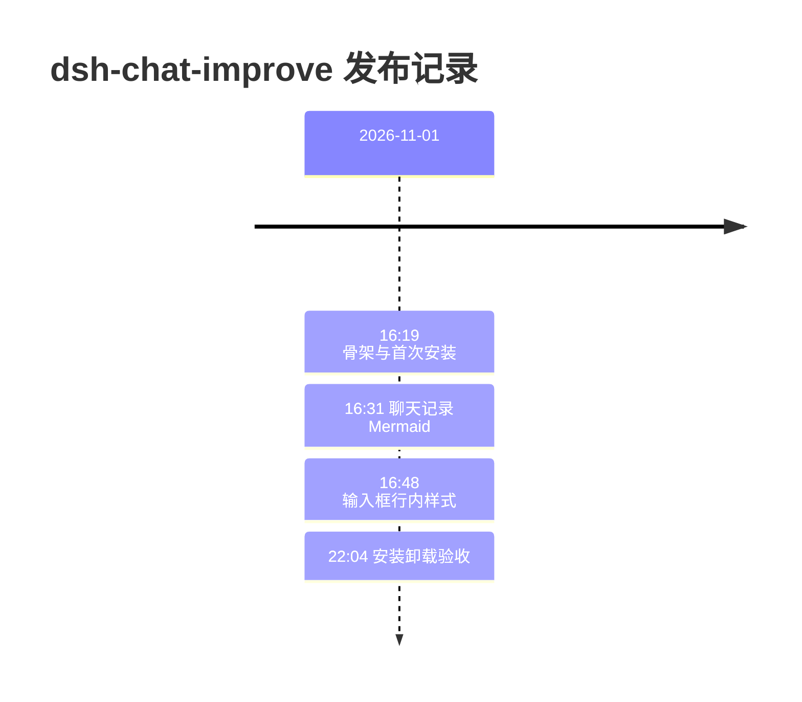

### 2.2 甘特图

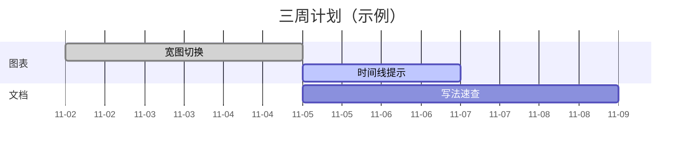

### 2.3 雷达图

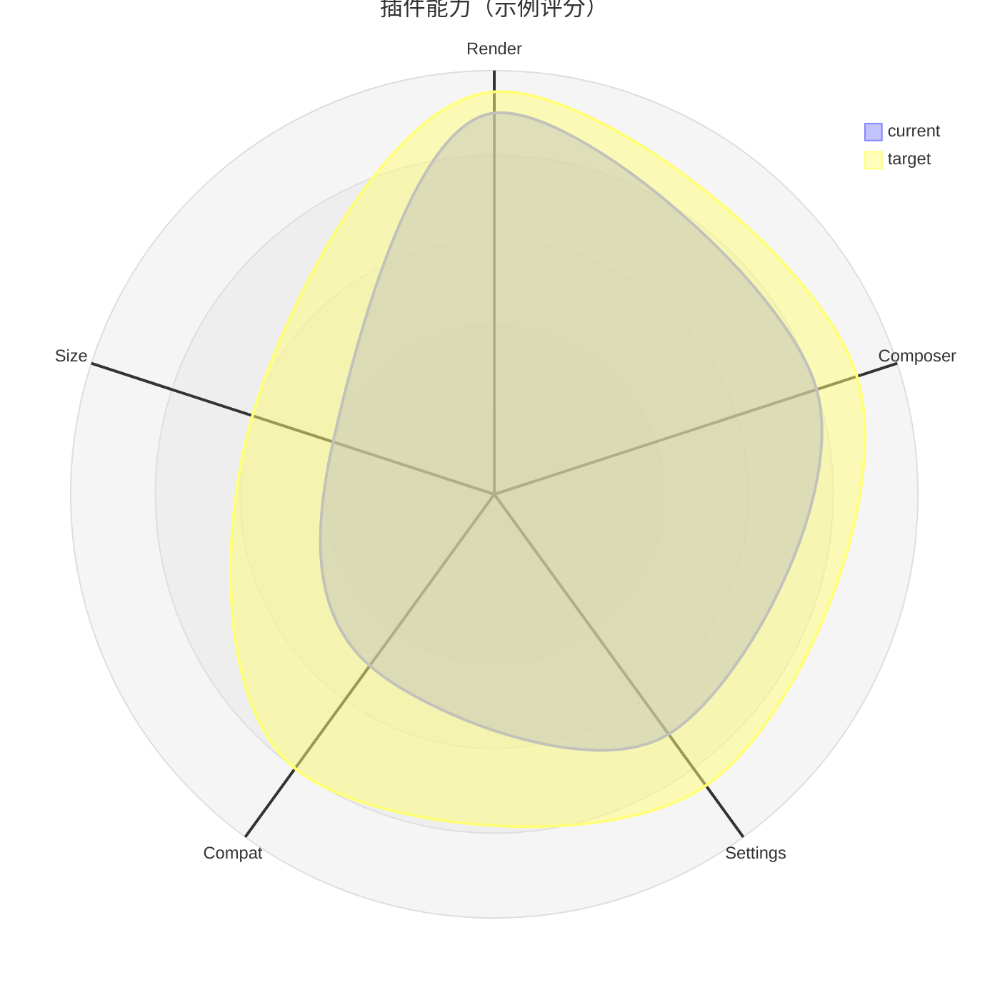

### 2.4 矩形树图

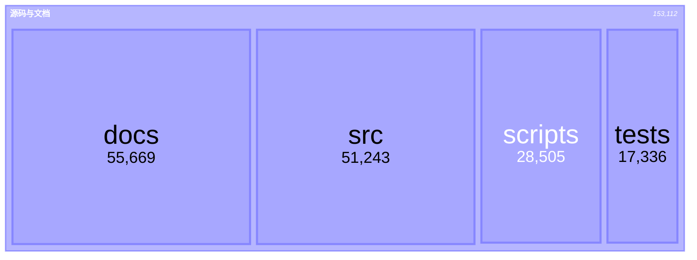

### 2.5 柱线图

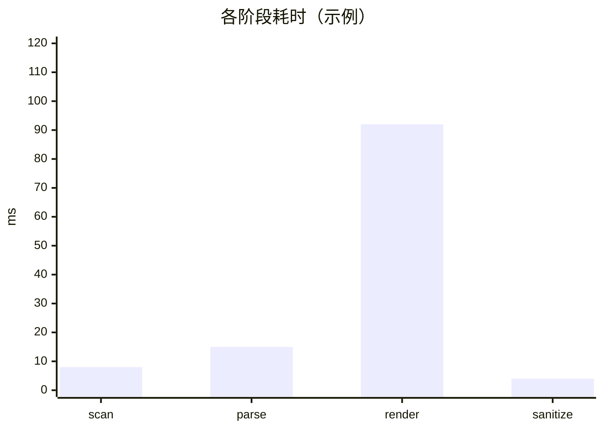

### 2.6 桑基图

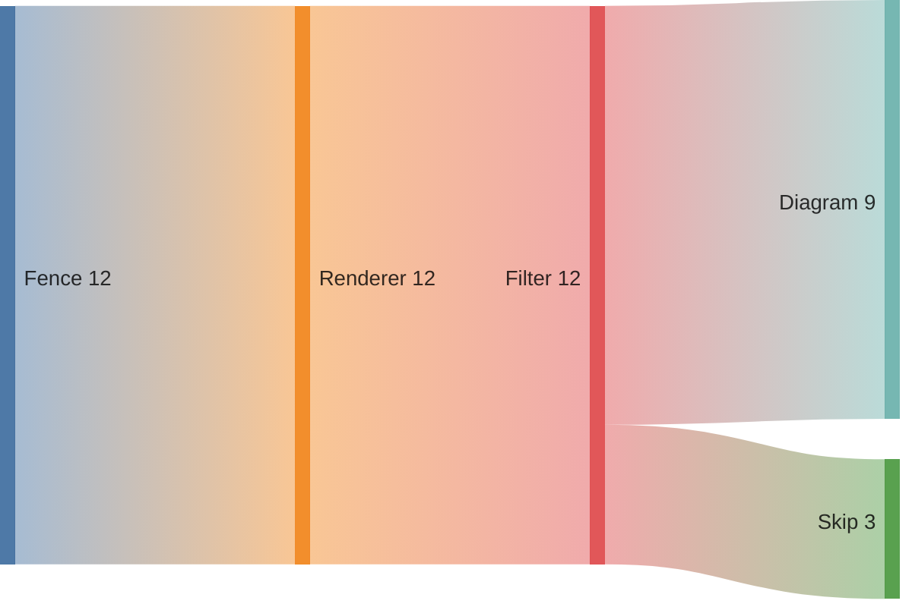

### 2.7 数据包

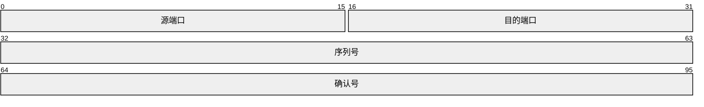

### 2.8 块布局

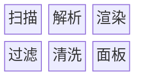

### 2.9 流程（ELK）


### 2.10 需求图

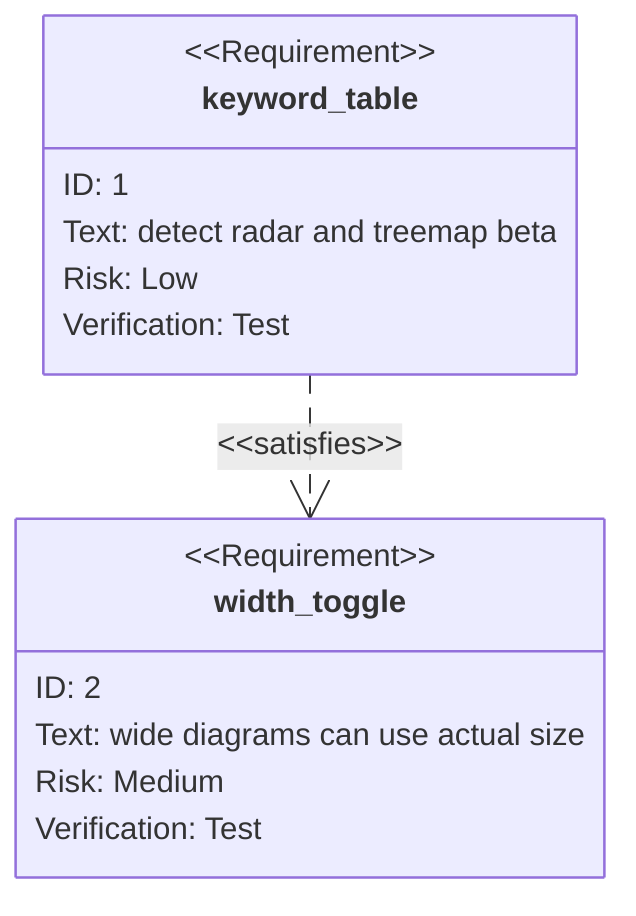

### 2.11 集合图

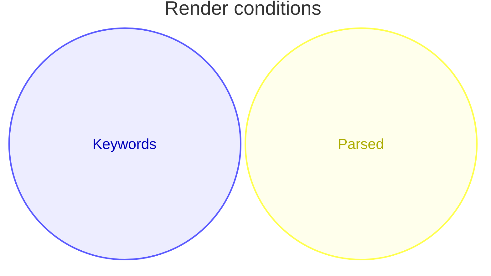

### 2.12 因果图

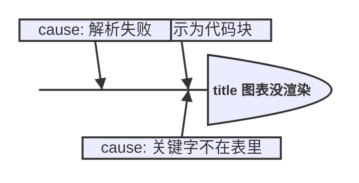

### 2.13 树视图


### 2.14 铁路图

```mermaid
railroad-ebnf-beta
    period = ( char - ":" )+ ;
```

### 2.15 架构图


### 2.16 能力地图

```mermaid
wardley-beta
    title Capability map (sample)
    component render [0.3, 0.8]
    component composer [0.6, 0.5]
    component settings [0.4, 0.2]
```

### 2.17 其它已渲染类型

这些类型在首轮 gallery 里渲染通过，但没有纳入最终 16 类逐类型验收；按标准语法写，仍要 parse。

| 类型 | 最小形状 |
| --- | --- |
| `flowchart` | `flowchart TD` + `A --> B` |
| `sequenceDiagram` | `sequenceDiagram` + `A->>B: hi` |
| `classDiagram` | `classDiagram` + `class A` |
| `stateDiagram-v2` | `stateDiagram-v2` + `[*] --> Idle` + `Idle: 空闲` |
| `erDiagram` | `erDiagram` + `A ||--o{ B : has` |
| `pie` | `pie` + `"A": 1` + `"B": 2` |
| `quadrantChart` | `quadrantChart` + `x-axis low --> high` + `A: [0.3, 0.6]` |
| `mindmap` | `mindmap` + `root` + `  child` |
| `gitGraph` | `gitGraph` + `commit` + `branch dev` + `commit` |
| `kanban` | `kanban` + `Todo` + `  task1` |
| `journey` | `journey` + `section Work` + `task: 5: Me` |
| `C4Context` | `C4Context` + `Person(p, "P")` + `System(s, "S")` + `Rel(p, s, "uses")` |

## 3. 类型选择

只列有记录依据的选择；没列出的类型按 §1 表和标准语法写。

| 需求 | 类型 | 要点 |
| --- | --- | --- |
| 事件/时间点 | `timeline` | 时间放事件文本；period 不含 `:` |
| 任务/工期 | `gantt` | 用 `dateFormat`/`axisFormat`；宽度跟页面走 |
| 多轴评分 | `radar-beta` | axis/curve 用 ASCII；title 可中文 |
| 流量/转化 | `sankey` | 节点名用 ASCII；每行 3 个字段 |
| 部分与整体 | `pie` / `treemap-beta` | treemap 的标签可中文 |
| 柱/线 | `xychart` | 中文 title/categories 加引号 |
| 架构 | `architecture-beta` | 必须带 `-beta` |
| 需求 | `requirementDiagram` | 中文 `text` 加引号 |
| 集合 | `venn-beta` | 中文 `set` 加引号 |
| 因果 | `ishikawa-beta` | 中文可 |
| 能力地图 | `wardley-beta` | 中文 `component` 加引号 |
| 协议字段 | `packet` | 中文可 |
| 块布局 | `block` | 中文可 |
| 流程 | `flowchart` / `flowchart-elk` | 标准节点/边 |
| 状态 | `stateDiagram-v2` | 每个 state 写 label |

## 4. 边界案例：bad → fix

### 4.1 timeline 的 period 不能含冒号

Mermaid 的 timeline 词法把 `:` 当 period/event 边界；period 规则是 `[^#:\n]+`。`2026-11-01 16:19 : step` 会在 `16` 后截断，报 `INVALID`。加引号也不救。

不要：

```text
timeline
    title 发布
    2026-11-01 16:19 : step 0
```

要：

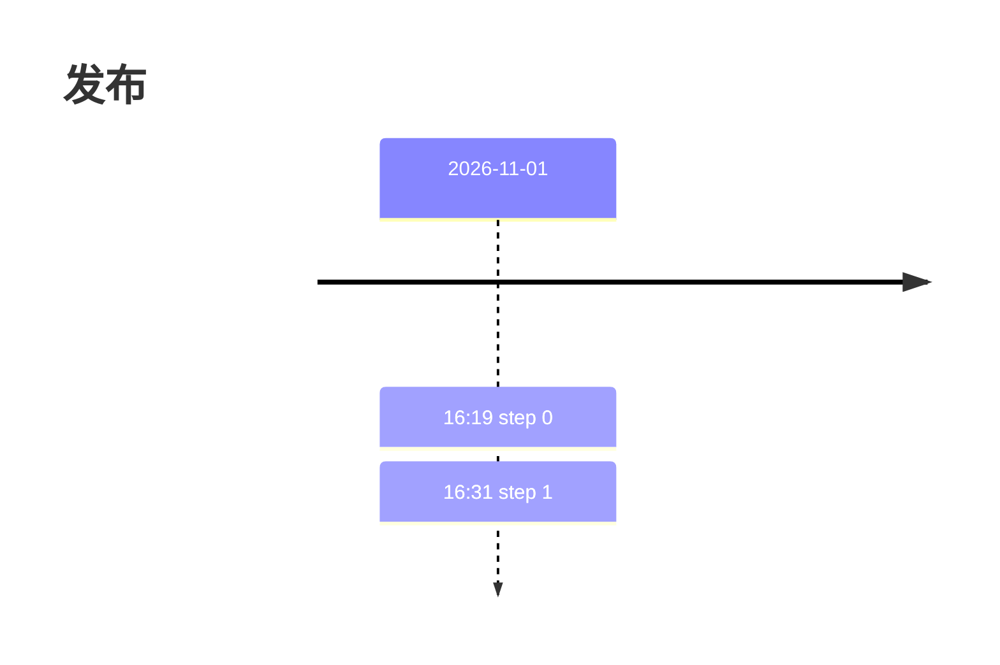

确实要按时刻排列时，把 period 写成 `16.19` 这类不含冒号的形式。

### 4.2 gantt 宽度跟页面走

实测：800px 视口得到 760px，1400px 视口得到 1360px，1600px 视口得到 1560px；与任务跨度无关。聊天列里会被 `max-width:100%` 压扁，字随之变小。

- 不要用任务跨度、`axisFormat`、`todayMarker` 去“控制宽度”。
- 用面板上的“原始大小 / 适合宽度”；“原始大小”会设 `max-width:none` 并按 viewBox 设宽高，容器已有 `overflow-x:auto`。
- 写图时接受它需要横向滚动；不要承诺“任务少就一定窄”。

### 4.3 中文与引号

规则：默认 ASCII；只有下表“引号”列通过的字段可以试中文；`radar-beta` 的 axis/curve 与 `sankey` 的节点名不要中文；所有图交付前 parse。

| 类型/字段 | 中文不加引号 | 中文加引号 | 做法 |
| --- | --- | --- | --- |
| `radar-beta` axis/curve | 失败 | 失败 | ASCII |
| `sankey` 节点名 | 失败 | 失败 | ASCII |
| `requirementDiagram` `text` | 失败 | 通过 | 加引号 |
| `venn-beta` `set` | 失败 | 通过 | 加引号 |
| `wardley-beta` `component` | 失败 | 通过 | 加引号 |
| `xychart` title/categories | 失败 | 通过 | 加引号 |
| `packet`/`block`/`treemap`/`ishikawa`/`flowchart`/`architecture-beta` | 通过 | 通过 | 中文可用 |

说明：`docs/logs/step-09` 曾把这五类都写成“只吃 ASCII”；后续复测和本轮 11.17.2 验证表明，`requirement`/`venn`/`wardley`/`xychart` 的对应字段加引号可以通过，`radar`/`sankey` 仍不行。以本表为准，但安装版本低于 11.17.2 时重新验证。

### 4.4 裸 `architecture` 不解析

`architecture` 会被 Mermaid 的 detector 认成架构图，但 parser 只认 `architecture-beta`；把裸写收进关键字表只会把普通代码块变成错误面板。

不要：`architecture`；要：`architecture-beta`。

### 4.5 strict、HTML 标签与 sanitize

渲染配置是 `securityLevel:'strict'`、`htmlLabels:false`，输出还会经 `sanitizeSvg` 移除 `script`、`foreignObject`、`iframe`、`object`、`embed`、`on*`、`javascript:`/`vbscript:`/`data:` 链接。不要用 HTML 标签、`click` 回调或这些链接；用 SVG 文本。

### 4.6 源码上限与流式

- 默认 `mermaidMaxSourceChars` 是 20,000；超了不会渲染，保持代码块。
- `maxTextSize` 最小 1,000；`maxEdges` 是 500。
- 流式消息里的块会跳过，流结束后再扫；不要在半流式时判断“没渲染”。

### 4.7 state 节点漏 label

`stateDiagram-v2` 的默认 label 就是 ID；`Skipped` 会显示成 `Skipped`。每个 state 写 `ID: 显示名`，除非 ID 就是想要的文字。

### 4.8 `%%{init}%%` 配色

记录里一次 `xychart` 的 `plotColorPalette` 指令没有生效，柱色仍是 base 主题的淡黄；根因未定。不要把 `%%{init}%%` 当可靠的主题覆盖手段；要改色先在目标主题真实 render 验证。

## 5. 宽图、主题、空状态

- **宽图**：`viewBox.width > content.clientWidth` 时显示“原始大小 / 适合宽度”；`clientWidth` 为 0（列隐藏/未布局）按溢出处理。默认 fit-to-column；切换是每张图的瞬时状态，不写设置。
- **主题**：`readThemeVariables` 从 14 个 `--dsw-alias-*` token 生成 `themeVariables`，缓存键含主题快照；主题变化清缓存并重渲染。不要硬编码颜色。xychart 的柱色可能偏淡，这是已知视觉坑，不是 parse 失败。
- **空状态/错误**：parse 失败时保留 `<pre>` 源码，显示“Mermaid 渲染失败。重试”；源码超限保持代码块；不显示半成品 SVG。
- **未覆盖**：tooltip（本插件没有 tooltip 层）、空数据语义、数组长度/轴范围校验。不要编规则。

## 6. 插件开发附录

只在改 `dsh-chat-improve` 的 Mermaid 管线时读这一节。

### 6.1 DOM 缝

- DSH 代码块：`div.md-code-block` > `[data-code-block-content]` > `pre`；没有 fence language，banner 显示本地化的“代码”。
- 只处理 `_markdown_` 根下、非 `[data-streaming]` 的块；源码长度按设置过滤。
- 不要试图从 `.infostring` 读 `mermaid`；它不可靠。

### 6.2 检测表

- `src/mermaid/detect.js` 的 `DIAGRAM_KEYWORDS` 是手抄 Mermaid detector 的快照；`looksLikeMermaid` 只认首词 + 空格/制表符。
- 新增/删除类型：更新表，补正负测试，跑 `node scripts/check-keywords.mjs`。该脚本从已安装 Mermaid 的 detector 正则抽首 token，和表比对；缺词退出码 1。
- `scripts/check-keywords.mjs` 只做事后检查，不接 CI；升级 Mermaid 后手动跑。
- 不要收裸 `architecture`；不要收 `info`。

### 6.3 引擎

- `mermaid.initialize` 每次 render 前调用：`startOnLoad:false`、`securityLevel:'strict'`、`theme:'base'`、`htmlLabels:false`、`themeVariables`、`maxTextSize`、`maxEdges:500`、flowchart/sequence/class/state/er 的 `htmlLabels:false`。
- `mermaid.parse(code, { suppressErrors:true })` 返回 `false` 即失败；`renderDiagram` 用 Promise 队列串行化。
- `mermaid.render(id, code)` 后必须 `sanitizeSvg`；`finally` 清理 `#d<id>`/`#<id>` 残留。
- 不要跳过 parse 直接 render；错误面板依赖 parse 失败。

### 6.4 主题与宽度

- `readThemeVariables` 读 14 个 token；`themeKey` 是缓存键；`refreshTheme` 清缓存、恢复源码、重扫。
- `attachWidthToggle` 在面板插入后测量 `viewBox` 与 `content.clientWidth`；`viewBox` 用属性字符串解析，不依赖 `SVGSVGElement.viewBox`。
- `timelineHintNeeded` 只认“`: ` 前含 `H:MM`”的 timeline 失败；其他非法 timeline 只有通用错误文案。

### 6.5 新增类型检查清单

1. 更新 `DIAGRAM_KEYWORDS`。
2. 在 `tests/detect.test.js` 加正例/负例；在 `tests/keywords.test.js` 确认 `mermaid.detectType` 认。
3. `npm test` 全绿。
4. `node scripts/check-keywords.mjs` 输出 `missing: none` / `not in mermaid: none`。
5. `npm run build` 成功；包体变化可接受。
6. 用真实浏览器/16 类 gallery 渲染一次；确认没有“检测认了、parse 失败”的假阳性。

## 7. 验证

### 7.1 Parse（必须）

在插件仓库根目录运行（需要 `jsdom` + `mermaid`，两者已在 devDependencies）：

```bash
node --input-type=module -e '
import { readFileSync } from "node:fs";
import { JSDOM } from "jsdom";
const dom = new JSDOM("<!doctype html><html><body></body></html>");
globalThis.window = dom.window; globalThis.document = dom.window.document;
globalThis.DOMParser = dom.window.DOMParser; globalThis.XMLSerializer = dom.window.XMLSerializer;
const mermaid = (await import("mermaid")).default;
mermaid.initialize({ startOnLoad: false, securityLevel: "strict", theme: "base", htmlLabels: false, maxTextSize: 20000, maxEdges: 500 });
const result = await mermaid.parse(readFileSync(process.argv[1], "utf8"), { suppressErrors: true });
console.log(result === false ? "FAIL" : "OK");
' chart.mmd
```

不要把 `FAIL` 说成“已渲染”。

### 7.2 插件回归

```bash
npm test
node scripts/check-keywords.mjs
npm run build
```

- 16 类模板逐条 parse；`foreignObject=0`；控制台零错误。
- gantt 宽图在 600px 列 + 1600px SVG 的桩里验证“原始大小/适合宽度”。
- Desktop 窗口没有独立 DOM 断言；不要声称 Desktop 已验证。

## 8. 失败 → 规则索引

| 失败 | 规则 |
| --- | --- |
| timeline period 含 `HH:MM` | §4.1：时间移到 `: ` 后，或 period 用 `16.19` |
| 关键字表漂移，`radar-beta`/`treemap-beta` 等不渲染 | §1：精确首词；升级跑 `check-keywords` |
| 裸 `architecture` 变错误面板 | §4.4：只用 `architecture-beta` |
| gantt 被压扁 | §4.2：预期宽图，用“原始大小” |
| radar/sankey 中文 Lexer error | §4.3：ASCII |
| requirement/venn/wardley/xychart 中文失败 | §4.3：加引号 + parse |
| `mermaid.detectType` 在 initialize 前抛错 | §6.3：先 initialize |
| `%%{init}%%` 配色不生效 | §4.8：不依赖，先真实 render |
| state 显示 ID | §4.7：每个 state 写 label |
| 源码超 20,000 字符不渲染 | §4.6：拆图或调设置 |
| 半成品/错误面板 | §5：保留源码 + 错误 + 重试 |

## 9. 版本与漂移

- 升级 Mermaid/DSH 后：先跑 `node scripts/check-keywords.mjs`，再用 §7.1 parse 16 类模板；更新 `metadata.verifiedAgainst`。
- 关键字/lexer 行为变化时，先改 `DIAGRAM_KEYWORDS` 和 §4.3 矩阵，再改示例。
- `metadata.requires` 是最低支持，`metadata.verifiedAgainst` 是实测；DSH 不会因版本不匹配拒绝加载。
- 如果安装版本低于最低值：把本技能当“未验证清单”，所有图先 parse，不要直接照抄矩阵结论。

## 10. 已知限制

- 没有覆盖 tooltip、空数据、数组长度/轴范围校验。
- 中文/引号矩阵只覆盖已测字段；其它字段可能不同。
- 视觉质量不保证：xychart 柱色、gantt 宽图、timeline 高列、ER 窄，都是已知但未修的视觉问题。
- `%%{init}%%` 根因未定。
- `swimlane-beta`、`cynefin-beta`、`eventmodeling`、`railroad-{beta,abnf,peg}` 只到关键字级。
- Desktop 窗口没有独立 DOM 断言；Web/Edge 验证不等于 Desktop 验证。
